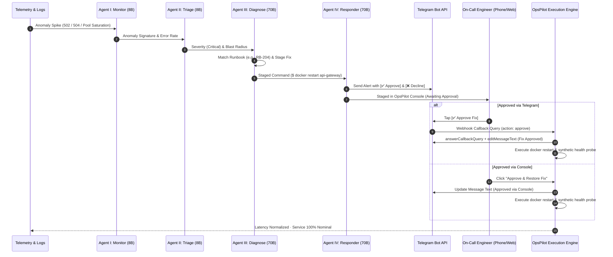

<div align="center">

# 🏛️ OpsPilot

### **Autonomous Multi-Agent Incident Response & Site Reliability Engineering Platform**

[](https://nodejs.org/)
[](https://www.typescriptlang.org/)
[](https://react.dev/)
[](https://expressjs.com/)
[](https://vitejs.dev/)
[](https://tailwindcss.com/)
[](https://core.telegram.org/bots/api)
[](https://render.com)
[](LICENSE)

*Old-world control room discipline meets modern autonomous agent intelligence. Stage, triage, diagnose, and remediate production incidents in seconds with human-in-the-loop Telegram sign-off.*

---

</div>

## 📌 Executive Summary

Modern engineering teams face chronic on-call burnout: alerts fire indiscriminately, root-cause investigation is fragmented across scattered dashboards, and human engineers scramble to find the right runbook under pressure.

**OpsPilot** is an autonomous AI incident response platform engineered to eliminate on-call friction. It continuously watches production telemetry across edge microservices, instantly deploys a coordinated pipeline of four specialized autonomous AI agents to diagnose anomalies against real runbooks, and stages executable remediation commands. 

Rather than executing changes blindly, OpsPilot enforces **Human-in-the-Loop governance** by dispatching instant interactive alerts to Telegram with **`[✅ Approve Fix]`** and **`[❌ Decline]`** buttons. When an engineer taps approve in Telegram or inside the console, the remediation runs immediately, synthetic readiness probes verify system recovery, and all actions are recorded in an audit trail.

---

## 🏛️ Key System Capabilities

- **🤖 4-Agent Coordinated Pipeline**:
  - **Agent I — Monitor**: Real-time log stream anomaly parsing and metric threshold spike detection.
  - **Agent II — Triage**: Severity classification (`Low` / `High` / `Critical`) and blast radius impact calculation.
  - **Agent III — Diagnose**: Root cause deduction, pattern matching against runbooks, and staging executable recovery commands.
  - **Agent IV — Responder**: Incident synthesis, contextual alert dispatch, and interactive human sign-off gating.
- **⚡ Dual-Tier Inference Engine**:
  - High-speed anomaly detection using `llama-3.1-8b-instant`.
  - Deep architectural reasoning and runbook matching using `llama-3.3-70b-versatile`.
  - Built-in zero-latency deterministic SRE fallback scenarios ensuring 100% offline uptime and demo reliability.
- **📱 Real-Time Interactive Telegram Integration**:
  - Inline keyboards featuring `[✅ Approve Fix]` and `[❌ Decline]`.
  - Secure webhook endpoint (`POST /api/telegram/webhook`) with secret token verification (`X-Telegram-Bot-Api-Secret-Token`).
  - Calls `answerCallbackQuery` and `editMessageText` to immediately seal the alert upon engineer action.
  - 1-second client-side live status polling so web dashboards turn nominal in real-time when approved from a phone.
- **🎨 Luxury Editorial Art Direction**:
  - Deep midnight ink (`#0b0f17`) background with warm antique gold (`#c9a45c`) hairline double-stroke borders.
  - Hardware-accelerated 3D kinetic alabaster torus motion background video with tab-visibility awareness and zero GPU lag.
  - Cormorant Garamond serif headings, JetBrains Mono telemetry metrics, and frosted glassmorphism.
- **🛡️ Enterprise Security Model**:
  - Zero client-side secret exposure: all API keys, bot tokens, and webhook secrets reside strictly in server `process.env`.
  - Client communicates exclusively via relative REST paths (`/api/...`).
- **🚀 Single Node Web Service**:
  - Engineered for zero-configuration, single-process deployment on **Render**, **Railway**, **Docker**, or **Cloud Run**.
  - Express serves static production assets with full client-side SPA fallback routing.

---

## 🔄 Multi-Agent Incident Architecture



---

## 📋 Production Topology & Scenario Matrix

| Service | Cluster | Metric Anomaly | Runbook | Staged Remediation Command |
| :--- | :--- | :--- | :--- | :--- |
| **API Gateway** | `core-ingress-02` | Rate-limit token bucket lock contention, 74% 504 cascade | **RB-204** | `docker restart api-gateway` |
| **Web Frontend** | `edge-cluster-01` | SSR worker V8 heap leak (98.7% heap, 38% 502 errors) | **RB-101** | `docker restart web-frontend-ssr` |
| **Database Pool** | `pg-primary-nvme-01` | 500/500 connection slot saturation, idle-in-transaction locks | **RB-309** | `docker restart pgbouncer-pooler` |

---

## 🔌 API Specification

All endpoints are hosted on the same origin and consume/return standard JSON payloads.

### Health & Observability
- `GET /api/health`
  - Returns `{"ok":true,"groq":boolean,"telegram":boolean}` without exposing credentials. Used by Render and cloud load balancers for readiness probes.
- `GET /api/status`
  - Returns connection metadata, active AI model routing configuration, and timestamp.

### Multi-Agent Pipeline
- `POST /api/agent`
  - Request: `{ agentRole: "monitor"|"triage"|"diagnose"|"responder", serviceId, scenarioTitle, logs, previousOutputs }`
  - Response: `{ ok: true, output: string, model: string, latencyMs: number, metadata }`

### Telegram Bot & Incident Synchronization
- `POST /api/telegram`
  - Dispatches incident alert with inline action buttons (`approve:<id>` and `decline:<id>`).
- `POST /api/telegram/webhook`
  - Handles incoming Telegram updates (messages and button callback queries), validates `X-Telegram-Bot-Api-Secret-Token`, answers callback queries, edits message text, and updates incident state in memory.
- `GET /api/incidents/:id/status`
  - Polled at 1-second intervals by the web UI to detect approvals executed from Telegram.
- `POST /api/incidents/:id/resolve`
  - Resolves an incident from the in-app console and syncs the Telegram message.
- `POST /api/incidents/:id/decline`
  - Acknowledges an incident without automated execution.
- `POST /api/telegram/set-webhook`
  - Registers the deployed application webhook URL with Telegram's `setWebhook` API.
- `GET /api/telegram/config`
  - Inspects bot identity (`@botname`, ID) and checks for self-chat misconfigurations.
- `POST /api/telegram/chat-id`
  - Overrides destination chat ID in memory and persists for demo sessions.
- `POST /api/telegram/auto-detect-chat`
  - Automatically captures the user's Chat ID from recent messages sent to the bot.

---

## 🛠️ Getting Started (Local Development)

### Prerequisites
- [Node.js](https://nodejs.org/) version **20.x or 22.x**
- [npm](https://www.npmjs.com/) (bundled with Node)

### 1. Clone Repository & Install Dependencies
```bash
git clone https://github.com/iTzinvi-dev/opsPilot.git
cd opsPilot
npm install
```

### 2. Configure Environment Variables
Copy the template file to `.env`:
```bash
cp .env.example .env
```
Edit `.env` with your credentials:
```env
# Server Port (optional, defaults to 3000)
PORT=3000

# Optional: Groq API Key for live LPU inference (https://console.groq.com)
GROQ_API_KEY="gsk_..."

# Optional: Telegram Bot Token from @BotFather (https://t.me/BotFather)
TELEGRAM_BOT_TOKEN="123456789:AA..."

# Optional: Personal Telegram numeric Chat ID (obtain via @userinfobot)
TELEGRAM_CHAT_ID="987654321"

# Optional: Secret token for webhook callback validation
TELEGRAM_WEBHOOK_SECRET="your_custom_secret_phrase"

# Optional: Publicly accessible URL for Telegram webhook delivery
APP_URL="https://your-domain.com"
```
*(Note: If credentials are not provided, OpsPilot automatically operates in Standby Mode using its deterministic SRE incident simulations and phone toast notifications).*

### 3. Launch Development Server
```bash
npm run dev
```
Open **[http://localhost:3000](http://localhost:3000)** in your browser.

---

## 🚀 Single-Command Production Build

To test the production build locally:
```bash
npm run build
npm start
```
Express will bundle the Vite React client into `dist/` and serve both the static SPA and the `/api` routes from a single unified Node process on `http://0.0.0.0:3000`.

---

## ☁️ Deployment on Render

OpsPilot is engineered to deploy to [Render](https://render.com) as a single **Web Service**:

1. Create a new **Web Service** on Render and link your GitHub repository: `https://github.com/iTzinvi-dev/opsPilot`.
2. Configure the deployment settings:
   - **Environment**: `Node`
   - **Build Command**: `npm run build`
   - **Start Command**: `npm start`
   - **Health Check Path**: `/api/health`
3. Add Environment Variables in the Render dashboard:
   - `GROQ_API_KEY`: Your Groq API key.
   - `TELEGRAM_BOT_TOKEN`: Your Telegram Bot token.
   - `TELEGRAM_CHAT_ID`: Your personal numeric Chat ID.
   - `TELEGRAM_WEBHOOK_SECRET`: A secure random string.
   - `APP_URL`: Your Render service URL (e.g. `https://opspilot.onrender.com`).
4. Click **Deploy**.
5. Once deployed, open the **Settings** drawer in the OpsPilot console and click **"Connect Buttons"** to bind your Telegram webhook.

---

## 🔒 Security Best Practices

- **Never Commit Secrets**: Secrets must never be committed to git. `.gitignore` is configured to exclude all `.env*` files except `.env.example`.
- **Bot-Self-Chat Prevention**: Telegram bots are forbidden by Telegram API from sending messages to themselves. OpsPilot automatically detects if your `TELEGRAM_CHAT_ID` matches your bot ID and provides clear instructional prompts in the Settings drawer.
- **Webhook Authentication**: All callback queries sent by Telegram are verified against `TELEGRAM_WEBHOOK_SECRET` via the `X-Telegram-Bot-Api-Secret-Token` header.
- **Client Sanitization**: All Groq model outputs are stripped of raw chain-of-thought `<think>` tags and markdown code blocks to ensure clean telemetry presentation.

---

## 📄 License & Credits

Distributed under the **MIT License**.

Engineered by **[iTzinvi-dev](https://github.com/iTzinvi-dev)**.
Contributions, issue reports, and feature requests are welcome!
